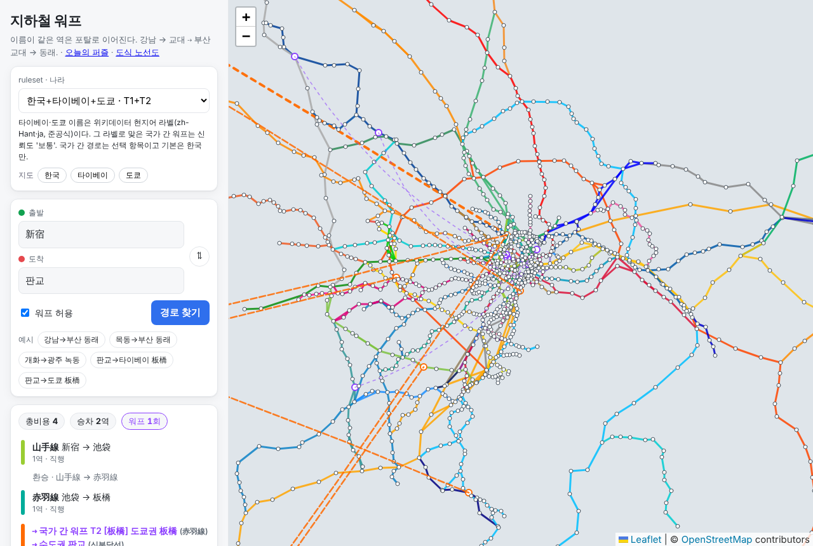

# 무인 작업 5차 T — Phase 1b 도쿄 (tokyo-phase1b, PR #8)

- 시작: 2026-11-09T12:19:40Z (세션 시작 직후 `date -u`, R과 같은 세션) · 명세: 사용자 /goal 메시지 T1~T3
- 브랜치 `tokyo-phase1b` = `run5-polish`(R, PR #7)에서 분기, draft PR #8 (베이스 = run5-polish)
- 커밋: `6b82c88` T1 → `ec45f9a` T2 → `6c11d4a` T3 → `9c79653` fun facts 국가 간 경로 → `97831df` T3 안내 문구 (+ R 최종 머지, 이 보고서)
- 테스트: pytest **225 통과** (`evidence/pytest_run5_t.txt`), node **42 통과** (`evidence/node_test_run5_t.txt`), 브라우저 E2E 에러 0 (`evidence/t3_browser.txt`)

## 요약

| 단계 | 상태 | 핵심 결과 |
| :- | :- | :- |
| T1 도쿄권 수집 | 완료 | Wikidata만으로 1도 3현 × JR東日本·東京メトロ·都営·대형 사철 8사: **물리 역 1,317 / 노선별 레코드 1,596 / 노선 100 / 승차 엣지 1,544**. 이름 = ja 라벨 native_label(준공식) + P1448 official 434. 순서 = P197 노선 한정자 + 역번호, 기하 검증 90개 시퀀스 중 83개 비율 1.000. 의심 목록 262건(대부분 P197 비대칭) |
| T2 3국 통합 그래프 | 완료 | 기존 ruleset 5종에 일본어만 더한 `ktj_*` 5종. ktj_t12: 클러스터 2,383, 국가 간 포탈 **KR–TW 6 · KR–JP 3 · TW–JP 3, 세 나라 공통 1 = 板橋**(서울 판교 · 도쿄 이타바시 · 타이베이 반차오). 허브 폭발 **없음** (T2 최대 차수 3) |
| T3 웹 | 완료 | 길찾기 ruleset 선택에 '한국+타이베이+도쿄' T1 / T1+T2 / T1+T2+T3a. 예시 '판교 → 도쿄 板橋' = 워프 한 번(2수). node 42 통과, 데스크톱·모바일 E2E |
| 시간이 남으면 | 일부 | fun facts 9장 '국가 간 경로 사례' 추가 (3국 지름 77수, 서울역 → 東京 12수 등). 테스트 보강(pytest +25: test_jp 18, test_world_ktj 7) |

## 1. 단계별 완료 증거

### T1. 도쿄권 역·노선·정차 순서 (Wikidata, 현지어 라벨 준공식 규칙)

생성: `python3 pipeline/22_fetch_jp_wikidata.py && python3 pipeline/23_build_jp.py` (범위 `config/jp_scope.yaml`), 상세 보고 `docs/reports/t1_tokyo_data.md`

- **소스**: Wikidata Query Service(CC0)만. SPARQL 6회(노선·역·역번호+한정자·인접 P197+한정자·현 소속 P131·P131 유무), 요청 간 3초, User-Agent에 프로젝트명, 원문 캐시 `data/raw/wikidata_jp/`. ODPT는 4차 결정(Q6-9)대로 접근하지 않았다.
- **범위**: 역 아이템의 P131 사슬이 東京都·神奈川県·埼玉県·千葉県에 닿고, 노선 아이템(P81)의 운영사(P137)가 JR東日本·東京メトロ·都営(지하철·도덴·닛포리토네리라이너)·東武·西武·京成·東急·京急·小田急·京王·相鉄인 것. 신칸센 3·화물 4·폐선 9 노선 아이템은 제외 목록. 경계를 넘는 노선은 현 경계에서 잘린다.

| 운영사 | 노선 | 노선별 레코드 |
| :- | -: | -: |
| JR東日本 | 31 | 552 |
| 東京メトロ | 9 | 182 |
| 都営 | 6 | 149 |
| 東武 | 7 | 133 |
| 東急 | 9 | 115 |
| 西武 | 12 | 105 |
| 京成 | 8 | 101 |
| 京王 | 7 | 78 |
| 京急 | 5 | 77 |
| 小田急 | 3 | 74 |
| 相鉄 | 3 | 30 |
| **합계** | **100** | **1,596** (물리 역 1,317) |

- **이름 (4차 Q6-1 규칙)**: ja 라벨 1,596 = native_label, 공식명 P1448(ja) 434 = official, en 라벨 1,594 = foreign_label(T3a에서만).
  - 라벨의 **운영사 구분 접두어**(Wikidata가 같은 이름 역을 운영사별 아이템으로 나눌 때 붙인 `JR東日本東京駅`, `東京メトロ南北線市ケ谷駅`, `京王電鉄 京王線新宿駅` 등 109개)는 공식명이 아니라서 뗐다. `京急蒲田·京成高砂·小田急相模原·東武練馬`처럼 공식 역명에 붙은 약칭은 남긴다. P1448이 있으면 그걸 표시 이름으로 쓴다. 테스트로 13가지 표기를 고정.
  - 동음이의 괄호(`府中駅 (東京都)`)와 끝의 `駅`·`停留場`를 뗀다 (`柏駅 → 柏`).
- **정차 순서**: P197 중 노선 한정자(pq:P81)가 그 노선인 진술 + 한정자 없는 진술은 두 역의 공통 범위 노선이 그 노선 하나일 때만. 방향은 노선 역번호 오름차순(노선 100개 중 84개가 역번호 접두어 확보). 역번호(P296)는 노선 번호(`JY01`, `G-09`)만 쓰고 전보약호(`ミウ`, `MI-U`)는 버린다.
  - JR은 Wikidata에 **인프라 노선**(東海道本線·東北本線·山手線 …) 단위로 걸려 있다. 같은 인프라 노선 위의 쾌속·직통 계통(사이쿄선·쇼난신주쿠라인 등)이 건너뛰기 인접(新宿–池袋 등)으로 들어 있어 순환이 생긴다. 타이베이(순환 = 데이터 오류라 버림)와 달리 **순환을 닫는 엣지 52개를 2역 연결 시퀀스로 보존**했다 (실제 운행 구간). 그래서 길찾기에 `山手線 新宿 → 池袋 1역`이 나온다 — 본선 시퀀스(田端 → … → 池袋 → 目白 → 高田馬場 → 新大久保 → 新宿 → … → 品川, 17역)는 따로 있다.
  - 신호장·분기점·화물역 아이템(29개)은 역에서 빼고, 인접 사슬은 그 시설을 건너뛰어 잇는다 (축약 17곳, 예: 西武新宿線 南入曽信号場).
- **검증 (두 근거)**: (1) P197 진술 자체 + 대칭성·역번호 연속성, (2) 좌표 기하(현재 순서 길이 / 좌표 최적 순서 길이, 4역 이상 시퀀스).

| 항목 | 값 |
| :- | :- |
| 기하 비율 계산한 시퀀스 | 90개, 그중 1.000 = 83개 |
| 기하 비율 1.05 초과 (순서 의심) | 2: 西武国分寺線 1.378, 成田線空港支線 1.545 (둘 다 지선·연결이 한 시퀀스에 섞인 형태) |
| 역번호 같은 접두어인데 이어지지 않는 인접 엣지 | 63 (대부분 지선 분기점·급행 건너뛰기, 예: 青梅線 立川 JC19 – 西立川 JC51) |
| 역번호는 이어지는데 인접 진술 없음 | 5 |
| P197 비대칭 (한쪽 역만 그 노선으로 인접을 적음) | 148 |
| 8km 넘는 인접역 | 16 (외곽 JR) |
| 노선(P81)에 걸렸지만 그 노선 인접 진술이 없는 역 | 28 (노선에서 뺌. `新大久保駅乗客転落事故` 같은 비역 아이템 포함) |

   의심 목록은 고치지 않고 `docs/reports/t1_tokyo_data.md`, `data/processed/jp/lines_validation.json`에 남겼다.
- 테스트(`tests/test_jp.py` 18개): 라벨 정리 13표기, 역번호 정규화(전보약호 버림), 비역 시설 패턴, 긴자선 G01 → G19 순서(渋谷 → 表参道 → 外苑前 …), 운영사 접두어·비역 시설 잔존 0, 이름 등급, 엣지 무결성.

### T2. 한국 + 타이베이 + 도쿄 통합 그래프 (ruleset별)

생성: `python3 pipeline/17_compare_world_rulesets.py --config config/world_compare_ktj.yaml` → `docs/reports/t2_world_ktj.md`, `data/processed/world_ktj/`

- ruleset: 기존 5종(`tw_t1`, `tw_t12`, `tw_t123`, 참고 `tw_t12_official`, `tw_t123b`)을 상속해서 일본어만 더한 `ktj_*` 5종. 새 옵션 2개(이 ruleset에만 켬):
  - T1 `separate_langs`: T1은 '같은 언어·같은 문자 정확 일치'라서 언어마다 따로 맞춘다. 이걸 안 켜면 zh `板橋`와 ja `板橋`가 문자열이 같아 T1(비용 1)로 묶여 정의와 어긋난다 → 테스트로 고정.
  - T2 `script_check_as: {Jpan: Hani}`: 일본어 이름은 한자만으로 된 경우에만 T2. 가나가 섞이면 이체자 비교 대상이 아니다.
  - 정규화 `char_map: {ヶ: ケ}` (`霞ヶ関`/`霞ケ関`, `市ヶ谷`/`市ケ谷`).
- **회귀 확인**: 기존 한국+타이베이 비교 결과(`data/processed/world/compare.json`)를 다시 만들어 바이트 동일.

**지표 (DESIGN 6장)** — 지름·평균은 워프 有 최대 컴포넌트 기준

| ruleset | 역 레코드 | 클러스터 | 승차 엣지 | 포탈 (등급별) | 워프 有 컴포넌트 | 최대 컴포넌트 | 지름 (양 끝) | 평균 | 워프 無 컴포넌트 |
| :- | -: | -: | -: | :- | -: | :- | :- | -: | -: |
| `tw_t12` (참고: 4차 한국+타이베이) | 1,292 | 1,110 | 1,248 | T1 29, T2 7 | 1 | 1,110 (100%) | 63 (가야대 → 신창) | 18.722 | 6 |
| `ktj_t1` | 2,888 | 2,383 | 2,792 | T1 33 | 4 | 1,271 (53.3%, 도쿄) | 70 (三崎口 → 和田浦) | 18.212 | 8 |
| **`ktj_t12`** | 2,888 | 2,383 | 2,792 | T1 33, T2 11 | 2 | 2,381 (99.9%) | **77 (和田浦 → 신창)** | 21.898 | 8 |
| `ktj_t123` | 2,888 | 2,383 | 2,792 | T1 33, T2 11 | 2 | 2,381 (99.9%) | 77 | 21.898 | 8 |
| `ktj_t12_official` | 2,888 | 2,383 | 2,792 | T1 29, T2 1 | 4 | 1,271 (53.3%) | 70 | 19.521 | 8 |
| `ktj_t123b` | 2,888 | 2,383 | 2,792 | T1 33, T2 11, T3b 2 | 2 | 2,381 (99.9%) | 77 | 21.581 | 8 |

**국가 간 포탈** (`ktj_t12`, 신뢰도 전부 medium — 현지어 라벨이 끼어 있음)

| 포탈 (접힌 키) | 원문 | 나라 | 연결 역 |
| :- | :- | :- | :- |
| **板桥** | 板橋 | **KR · TW · JP** | 서울 판교(신분당선·경강선) · 타이베이 板橋(板南線·環狀線) · 도쿄 板橋(赤羽線) |
| 三田 | 三田 | KR · JP | 서울 삼전(9호선) · 도쿄 三田(都営) |
| 田浦 | 田浦 | KR · JP | 부산 전포 · 요코스카 田浦(横須賀線) |
| 中山 | 中山 | TW · JP | 타이베이 中山 · 요코하마 中山(横浜線) |
| 府中 | 府中 | TW · JP | 신베이 府中 · 도쿄 府中(京王線) |
| 中咊 · 囘惇 · 土城 · 明徳 · 松山 | (4차와 같음) | KR · TW | 중화 · 회룡 · 토성 · 명덕 · 송산 |

- **板橋는 세 나라 공통이다** (4차 조사의 추정이 실데이터로 확인됨). 판교에서 도쿄 이타바시도, 타이베이 반차오도 T2 워프 한 번(2수).
- 4차 survey 추정 중 `太田 = 태전`은 이번 범위(1도 3현)에 太田駅이 없어서 안 생긴다 (도부 太田는 군마현).
- 도쿄 내부 T1(동명이역) 4개: 入谷(사가미선 ↔ 히비야선, 44km), 小川町(都営新宿線 ↔ 東武東上線, 61km), 霞ケ関(メトロ ↔ 東武東上線, 39km, `霞ヶ関/霞ケ関` 표기 차를 정규화로 접은 결과), 早稲田(東西線 ↔ 都電 정류장, **733m**). 큰 역(新宿·渋谷·池袋 등)이 500m 규칙에서 갈라진 사례는 없다.
- **허브 폭발 판정** (4차 기준: T2·T3 차수 ≥ 5, 포탈 수 ×2, 같은 범위 지름 20% 감소): **5종 모두 정상**. 등급별 최대 차수 T1 3, T2 3, T3b 2. `ktj_t12`의 지름은 오히려 70 → 77로 늘었다 (도쿄와 한국이 이어져 최대 컴포넌트가 커졌기 때문).
- 국내 우회: 한국 내 순서쌍 중 `ktj_t1`보다 짧아진 쌍 `ktj_t12` 7.79% (대부분 국내 T2 대치↔대티), 국가 간 포탈만 따지면 4.90% (fun facts 9장).
- 테스트(`tests/test_world_ktj.py`): 같은 한자 다른 언어 = T2(T1 아님), 일본 내부 T1·ヶ 접기·`@ja` id, 가나 섞인 이름 T2 제외, 기존 ruleset 옵션 불변, 3국 비교 결과(板橋 유일한 세 나라 포탈, 폭발 없음, KR–JP·TW–JP 포탈).

### T3. 웹 ruleset 선택에 도쿄 추가

- `web/world.js` RULESETS에 `ktj_t1` / `ktj_t12` / `ktj_t123` 추가 (번들 `world_ktj_*.json`, 각 약 0.9MB, `pipeline/06_build_web_data.py --countries KR,TW,JP`). 출처 표기에 '도쿄권: Wikidata (CC0)'. 국가 표기 JP = 일본.
- 예시 버튼 '판교 → 도쿄 板橋'은 ruleset을 `ktj_t12`로 바꾼 뒤 찾는다. 지도 보기 버튼에 '도쿄'. 도쿄 ruleset이면 안내 문구가 ja 라벨(준공식)을 언급.
- node 테스트 42 통과 (도쿄 관련 +2와 기존 world 루프에 ktj 3종): 3종 JS 길찾기 = Python 결과(각 94쌍), 板橋 세 나라 공통·판교 → 도쿄권 板橋 비용 2, KR–JP·TW–JP 포탈, `ktj_t1` 국가 간 0·도쿄 동명이역 4.
- 브라우저 E2E (`scripts/e2e_tokyo.cjs`, `evidence/t3_browser.txt`): 데스크톱·모바일(390×844)에서 선택지 표시, `판교 → 도쿄권 板橋 = 총비용 2 (국가 간 워프 T2 [板橋])`, 해시 `#from=新宿&to=판교&rs=ktj_t12` → `新宿 → 池袋 → 板橋 ⇢ 판교 = 4`, 에러 0.

### 시간이 남으면: 국가 간 경로 사례 (fun facts 9장)

`python3 pipeline/11_fun_facts.py` (`--world-ruleset ktj_t12`) → `docs/reports/fun_facts.md` 9장.

- 세 나라에서 가장 먼 두 역: **도쿄권 和田浦(지바 남단) → 수도권 신창 = 77수** (도쿄 板橋 ⇢ 판교 한 번).
- 나라 사이 최단: 서울역 → 東京 12수 (1호선 시청 ⇢ 부산 시청 → … 종합운동장 ⇢ 서울 종합운동장 → 삼전 ⇢[三田] → 東京), 台北車站 → 東京 12수, 부산 → 新宿 14수 (토성 ⇢ 土城 → 板橋 ⇢ 板橋), 東京 → 부산 17수.
- 해외를 거쳐야 짧아지는 국내 경로: 한국 4.90% (최대: 송산 → 판교 36 → 15수, 타이베이 경유), 대만 3.65%, 일본 0.68% (최대: 府中 → 板橋 11 → 5수, 대만 府中 경유).

## 2. 미완 단계와 사유

- 명세 T1~T3 중 미완은 없다.
- **공식명은 23%뿐**: 도쿄 역 이름은 대부분 Wikidata ja 라벨(준공식)이다. P1448 공식명 434건. ODPT(운영사 공식)는 4차 결정대로 접근하지 않았다.
- **JR 운행 계통(京浜東北線·埼京線 등)은 모델링하지 않았다**: Wikidata 역 아이템이 계통 아이템을 P81로 거의 안 가리킨다(계통 아이템은 좌표가 없어 '좌표 없음'으로 걸러진 61건에 들어 있다). 인프라 노선 단위라 노선 색·이름이 실제 안내와 다를 수 있다 (예: 京浜東北線 구간이 東北本線·東海道本線으로 보인다).
- **도식 노선도의 도쿄 패널은 만들지 않았다** (명세 범위 밖, 1,300역 규모라 수도권처럼 장시간 풀이가 필요).
- **데일리 퍼즐에 도쿄는 넣지 않았다** (R1은 한국+타이베이 주말 풀까지).
- 참고 ruleset 2종(`ktj_t12_official`, `ktj_t123b`)은 비교만 하고 웹 번들은 만들지 않았다 (번들 1개 0.9MB).
- 의심 목록 262건은 고치지 않았다 (두 근거가 같은 결론일 때만 보정한다는 2차 원칙. 이번엔 근거가 Wikidata 하나뿐인 항목이 대부분).
- 세션 네트워크: 레일포털(data.kric.go.kr) 역사정보 다운로드가 막혔다 (R 보고서 참고). 도쿄 작업에는 영향 없음.

## 3. 가정·판단

- '주요 사철' = 간토 대형 사철 8사(東武·西武·京成·東急·京急·小田急·京王·相鉄). 준대형·제3섹터(つくばエクスプレス, 東京臨海高速鉄道 りんかい線, 北総鉄道, 埼玉高速鉄道 등), 모노레일, 요코하마 시영 지하철은 넣지 않았다. 都営은 지하철 4개 + 都電荒川線 + 日暮里・舎人ライナー.
- 범위 = 1도 3현(P131 사슬). P131이 아예 없는 아이템만 좌표 범위(bbox)로 받았다 (2건: 志村車両検修場 — 인접 진술이 없어 노선에서 빠짐, 東京メトロ市ケ谷駅). 처음엔 현 쿼리가 1도 3현에 닿는 역만 돌려줘서 군마·도치기 역이 'P131 없음'으로 오인돼 들어왔다 → P131 유무를 따로 받아 고쳤다.
- JR 인프라 노선의 건너뛰기 인접(쾌속·직통 계통)은 실제 운행 구간이라 승차 엣지로 남겼다 (승차 1역 = 1수 규칙상 '쾌속 한 정거장'). 게임 난이도에는 영향이 있을 수 있다.
- 일본은 공식 환승 정보가 없어 환승 판정은 거리 D=500m 규칙 그대로. 早稲田(733m)는 그래서 T1 포탈이 됐다 — 한국 신촌(2호선 ↔ 경의선)과 같은 처리.
- T1 언어 분리는 새 ruleset(`ktj_*`)에만 켰다. 기존 `tw_*`는 한국어·중국어 문자가 겹치지 않아 결과가 같지만, 회귀 위험을 피하려고 옵션으로 뒀다.
- 포탈 신뢰도: 국가 간 포탈은 전부 현지어 라벨이 끼어 medium.
- 도시 표기는 '도쿄권'(웹 라벨 `도쿄권 新宿`). 역 이름은 일본어 그대로(한국어 독음 미표기).

## 4. 결정하거나 확인할 것

1. **사철 범위**: 대형 8사만으로 충분한지, つくばエクスプレス·りんかい線·横浜市営地下鉄·モノレール를 넣을지.
2. **JR 표현 단위**: 인프라 노선(지금)으로 둘지, 운행 계통(京浜東北線 등)으로 바꿀지. 계통으로 바꾸려면 Wikidata 대신 다른 소스(ODPT 등)가 필요해 보인다.
3. **건너뛰기 인접(新宿 → 池袋 1역)**: 승차 엣지로 둘지(지금), 각역정차 인접만 쓸지.
4. **早稲田처럼 가까운 동명역**: 역외 환승 목록(`kr_offsite_transfers.yaml`과 같은 방식)으로 묶을지, 포탈로 둘지.
5. **板橋 세 나라 포탈**: 비용 2(T2)로 둘지. 일본 쪽 板橋는 라벨 기준(준공식)이다.
6. 데일리·도식에 도쿄를 넣을지, 도쿄 공식명 소스(ODPT 키) 확보 여부.

## 5. 다음 할 일

- PR #7(R) → PR #8 순서로 리뷰·머지.
- 도쿄 의심 목록 중 P197 비대칭·역번호 공백을 두 번째 근거(공식 노선도 아님, 다른 오픈데이터)로 재검증.
- 도쿄 도식 패널(1,300역): R4의 웜스타트·장시간 풀이·캐시 방식 그대로 적용.
- 주말 데일리에 3국 퍼즐 추가 검토 (R1 주말 풀과 같은 방식, ruleset `ktj_t12`).
- 사철 범위 확대 시 `config/jp_scope.yaml` operators만 늘리면 된다.
