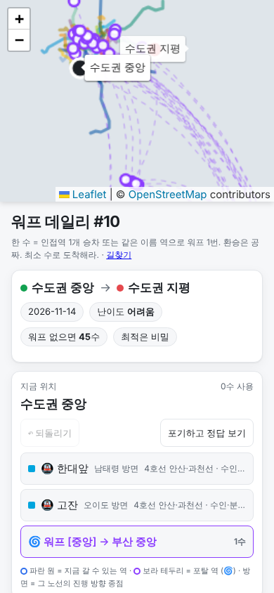
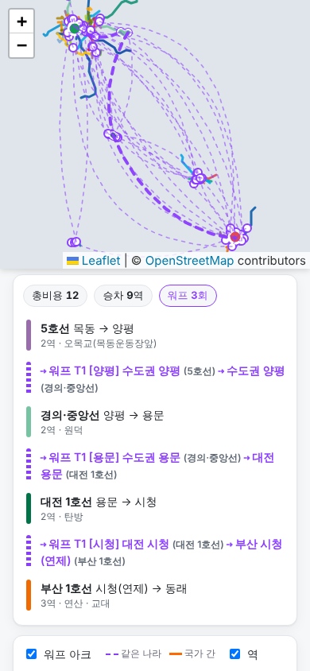
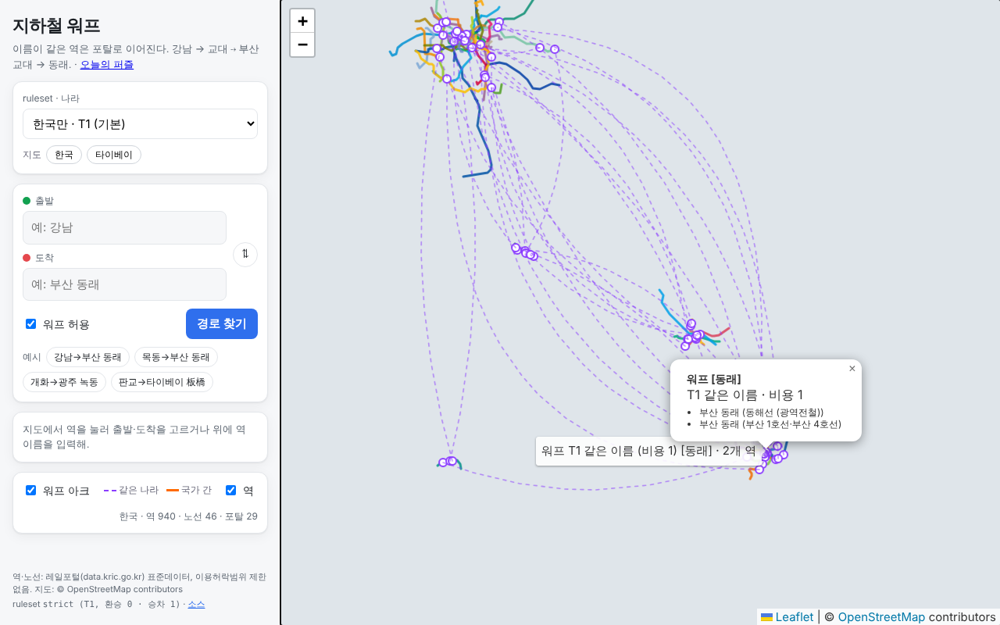

# 무인 작업 4차 Q — 데이터 갱신과 QA 반영 (qa-fixes, PR #5)

- 시작: 2026-11-06T06:42:14Z (세션 시작 직후 `date -u`) · 명세 `docs/tasks/run4_tasks.md` · 참고 `docs/research/qa_report.md`, `docs/research/kr_line_openings.md`
- 브랜치 `qa-fixes` (main에서 분기, PR #4가 이미 머지돼 있어서 명세대로 main 기준), draft PR #5
- 커밋: `6b52b4f` 자료 이동 → `3f3a368` Q0 → `272dc3b` Q6 → `c7ff7ff` Q2 → `ff971a6` Q1·Q3·Q4·Q5 (+ 이 보고서)
- 테스트: pytest **188 통과** (`evidence/pytest_run4_q.txt`), node **27 통과** (`evidence/node_test_run4_q.txt`), 브라우저 E2E **44/44** (`evidence/q_browser.txt`)
- 진행 순서 판단: Q6(그래프를 바꾸는 결정들)을 Q2(퍼즐 재생성)보다 먼저 했다. Q2가 최종 그래프 위에서 돌아야 비교가 의미 있다.

## 요약

| 단계 | 상태 | 핵심 결과 |
| :- | :- | :- |
| Q0 역 데이터 | 완료 | 원본은 이미 레일포털 `전체_도시철도역사정보_20260630` (재수집해도 산출물 동일). 검단연장·대경선(북삼)·대구1 하양·GTX-A 9역 **누락 0**. 자기부상 제외 공식 확인. 12월 개통 예정 3개 노선 `enabled: false` 등록, 켜면 새 포탈 **T1 신기** 1개 |
| Q1 데일리 버그 | 완료 | 해시 변경 반영, 역 이름 세로 줄바꿈 제거, 출시 전 날짜 → 1회차 + 안내 |
| Q2 퍼즐 다양성 | 완료 | 제약 4종 위반 **0** (3차: 시그니처 35·자카드 7·창 540·요일 58). 최다 포탈 점유 2차 동백 33% → 4차 시청 10%. 요일 난이도 지수 월 0.00 → 일 0.81 단조 증가 |
| Q3 데일리 UX | 완료 | 노선·방면 고정 정렬 + '○○ 방면', 포탈 역 강조, 완료 범례, 공유 문구에 되돌리기 횟수 |
| Q4 모바일 390px | 완료 (에뮬레이션) | 지도 sticky + 결과 자동 스크롤, 버튼 46px, 되돌리기·포기 첫 화면, 전체 경로 맞춤, 라벨 잘림 없음 |
| Q5 지도·표기 | 완료 | 아크 곡률 분산·짧은 아크 강조·클릭 팝업, 동명역 노선 병기, '역' 접미사 통일, favicon, 고아 노드 제외, 저줌 일반역 숨김 |
| Q6 3차 결정 9개 | 완료 | 이름 출처 등급 도입 → 한국-타이베이 국가 간 포탈 **0 → 6** (T2, 신뢰도 medium). 부전 역외 환승 재클러스터. T3 → T3a/T3b. T2 감사표 |

## 1. 단계별 완료 증거

### Q0. 역 데이터 갱신

증거: `docs/reports/evidence/q0_checklist.md` (`scripts/q0_checklist.py`), `docs/reports/q0_planned_preview.md` (`pipeline/18_planned_preview.py`), `docs/reports/evidence/run3_vs_run4.md` (`scripts/compare_run3_run4.py`)

1. **파일 버전**: 역사정보 `전체_도시철도역사정보_20260630.xlsx` (313,132 B), 노선정보 `전체_도시철도노선정보_20260630.xlsx`, 다국어 `전국 도시광역철도 역사 역사정보_20260701.xlsx`. 행별 데이터기준일자 최신값 2026-06-25. 3차부터 이미 이 파일이었다.
2. **최신본 교체**: 오늘 다시 받았고 산출물은 수집 시각 말고 바이트 단위로 같다 (결정성 확인).
3. **포함 확인** (전부 노선 시퀀스까지 들어 있음):

| 구간 | 역 | 근거 |
| :- | :- | :- |
| 인천1호선 검단연장 | 아라·신검단중앙·검단호수공원 | 표준데이터 S2801 3109/3108/3107, 기준일자 2025-06-30 |
| 대경선 + 북삼 | 구미·사곡·**북삼**·왜관·서대구·대구·동대구·경산 | 표준데이터 I27K7 7001~7008, 북삼 기준일자 2026-02-28 |
| 대구1호선 안심~하양 | 대구한의대병원·부호·하양 | 표준데이터 S2701 0147~0149 |
| GTX-A | 운정중앙·킨텍스·대곡·연신내·서울역 / 수서·성남·구성·동탄 | `config/kr_supplement.yaml` (다국어 파일 행, 신설일자 + Wikidata P1619). 서울역~수서 연결은 넣지 않음 |

4. **자기부상 제외**: DESIGN.md·`kr_scope.yaml`을 "공식 확인 (인천시 보도자료 2025-10-17)"으로 바꿨다. 20260630 원본에도 자기부상 6행이 아직 있어 제외 설정은 계속 필요하다.
5. **개통 예정 노선** (`config/kr_planned.yaml`, 전부 `enabled: false`, 좌표 = Wikidata P625 CC0, QID 기록):
   - 양산선 노포~사송~내송~양산시청~양산중앙(종합운동장)~신기~북정, 부산2호선 양산~양산중앙, 동해선 태화강~북울산
   - 켰을 때 미리보기 (strict): 클러스터 940 → 947, 포탈 29 → 30. **새 포탈 T1 신기 = 부산(양산선) 신기 ↔ 대구 1호선 신기** (같은 이름 확인). 노포·양산중앙은 기존 역과 환승으로 묶인다. 한국+타이베이 `tw_t123`에서도 같은 결과(Q6 전에는 ruleset `sources` 필터가 계획 역 이름을 빼서 신기가 안 잡혔는데, 출처 등급 필터로 바꾸며 해결). '종합운동장'은 괄호 부역명이라 서울·부산 종합운동장과 포탈을 만들지 않는다.
6. 교외선(일반철도)·위례·동북·신안산·GTX-A 서울역~수서 등은 넣지 않았다 (`kr_planned.yaml` not_added에 사유 기록).
7. **3차 ↔ 4차 전후 비교** (`evidence/run3_vs_run4.md`):

| 항목 | 3차 | 4차 | 원인 |
| :- | -: | -: | :- |
| 역(노선별 레코드) | 1100 | 1099 | 고아 레코드 광운대역[경의중앙선] 제외 (Q5) |
| 클러스터 | 941 | 940 | 부전 역외 환승 재클러스터 (Q6-3) |
| 승차 엣지 | 1065 | 1065 | |
| T1 포탈 | 30 | 29 | 부전 소멸 |
| 워프 有 지름 / 평균 | 67 / 17.77 | 67 / 17.757 | |
| 워프 無 컴포넌트 | 5 | 5 | |
| 국가 간 포탈 (tw_t12) | 0 | 6 | 이름 출처 등급 (Q6-1) |
| 퍼즐 풀 / 일정 | 104 / 104 셔플 | 374 / 182 제약 일정 | Q2 |
| 13정류장 대권거리 1위 | 371.4km 부산 동백 → 수도권 임진강 (워프 3) | 같음 | |
| 13정류장 구간 합 1위 | 73.5km 수도권 영종 → 운정중앙 (워프 0) | 같음 | |

### Q1. 데일리 버그 (`evidence/q_browser.txt`)

- 해시만 변경: `#d=2026-11-05` → `#d=2026-11-06` 시 P096(#1) → P312(#2)로 바뀜 (desktop·mobile PASS). `hashchange`에서 다시 읽는다.
- 세로 줄바꿈: 노선 태그가 가장 긴 날(2026-11-14 수도권 중앙, `4호선 안산·과천선 · 수인·분당선…` 28자)에 역 이름 칸 높이가 전부 한 줄(23px). 원인은 역 이름 칸이 flex로 줄어든 것 + 모바일 그리드 `1fr`의 최소폭. `nowrap`·`flex-shrink:0`, 태그 말줄임, 그리드 `minmax(0,1fr)`로 고쳤다.
- 출시 전 날짜: `#d=2026-11-04`, `#d=2020-01-01` 모두 `#1` + "출시일(2026-11-05) 이전 날짜라 1회차를 보여 줌" 칩. 없는 날짜(`2026-02-30`, `abc`)는 오늘로.

### Q2. 퍼즐 다양성 (`docs/reports/q2_daily_order.md`, `scripts/q2_compare.py`)

- 시그니처 = 최적 경로의 포탈 순서. 난이도 = 3차 직관 탐색 보정 난이도 (점수 = 최적 비용 / 지리 감각 최선 우선 탐색 비용, h = 1 − 점수).
- 하드 제약 (182일 순환 일정 기준): (i) 같은 시그니처 간격 ≥ 14일, (ii) 연속일 포탈 집합 자카드 ≤ 0.34, (iii) 30일 창 포탈별 ≤ 4회, (iv) 요일별 허용 등급 (월 easy, 화 easy/normal, 수·목 normal, 금 normal/hard, 토·일 hard).
- 풀이: 탐욕 + 국소탐색 (`metro_portal/daily_order.py`). ILP는 쓰지 않았다 — 탐욕+국소탐색으로 위반 0이 나왔다.

| 버전 | 풀 | 일정 | (i) | (ii) | (iii) | (iv) | 시그니처 최소 간격 | 서로 다른 시그니처 | 30일 창 최다 포탈 |
| :- | -: | -: | -: | -: | -: | -: | -: | -: | :- |
| 2차 (QA 배포본) | 101 | 101 | 26 | 8 | 498 | 54¹ | 1 | 47 | 동백 14 |
| 3차 (main) | 104 | 104 | 35 | 7 | 540 | 58 | 1 | 41 | 시청 11 |
| 4차 구방식 (같은 그래프에 3차 선정 + 셔플) | 101 | 101 | 33 | 6 | 522 | 52 | 1 | 43 | 동백 11 |
| **4차 신방식** | 374 | 182 | **0** | **0** | **0** | **0** | 14 | 102 | 시청 4 |
| 4차 유일성 완화판 (최적 경로 ≤ 3) | 374 | 182 | 0 | 0 | 0 | 0 | 14 | 108 | 용문 4 |

¹ 2차는 보정 난이도가 없어 규칙 난이도로 셌다.

- QA 지표 재현: 2차에서 최적 경로에 동백을 쓰는 퍼즐 **33/101**, 송정 **30/101** (QA 수치와 일치). 2차 1·3·4일차가 전부 `중동+동백` — QA가 본 반복이 데이터로 재현된다.
- 4차: 일정 182일에서 포탈별 최다 시청 18 (10%), 송정·동백·증산·중앙 17 (9%). 연속한 두 날 포탈 겹침 평균 0.0.
- 요일별 평균 h: 월 0.00 / 화 0.309 / 수 0.459 / 목 0.536 / 금 0.619 / 토 0.71 / 일 0.81 (3차는 0.46~0.59 사이에서 무작위).
- **Q2-5 유일성 완화**: 같은 선정 규칙의 풀에서 상위 포탈 쏠림이 유일 82·75·66(시청·송정·화정) vs 완화 76·70·61로 거의 같다. 쏠림의 원인은 유일성이 아니라 "단축 폭 순 선정"(큰 단축은 수도권↔부산·대구 다리 포탈에서만 나온다). 완화판도 일정 위반 0이라 유일 최적해를 유지했다.
- 민감도: 창 상한 3이면 요일 위반 2건, 5·자카드 0.5·시그니처 간격 28은 위반 0. **364일(1년) 일정은 현재 풀(374개)로는 불가** (탐욕만으로 위반 882건) — 1년치는 풀 확대가 필요하다.

### Q3. 데일리 UX

- 이동 후보: 승차 먼저, 노선 번호 → 방면(그 노선의 진행 방향 종점, 순환선은 3역 앞) 순으로 고정. 예: 수도권 중앙에서 `한대앞 · 남태령 방면`, `고잔 · 오이도 방면`, 그 뒤 워프. node 테스트로 신도림 2호선 두 방향이 서로 다른 방면인지, 매 수 같은 순서인지 고정.
- 포탈 역: 지도에 보라 테두리 원 + 툴팁(어디로 워프되는지), 이동 버튼에 🌀.
- 완료 범례: 노선 색 실선(내 승차), 보라 굵은 점선(내 워프), 초록 점선(최적 경로), 연보라 가는 점선(모든 워프 연결).
- 공유 문구 마지막 줄 `↶ 되돌리기 n회` (점수 영향 없음, 테스트로 고정).

### Q4. 모바일 390px (Playwright 390×844, isMobile·hasTouch 에뮬레이션)

| 항목 | 결과 |
| :- | :- |
| 길찾기 결과 위치 | 지도를 화면 위 40vh에 sticky로 고정하고 결과로 자동 스크롤 → 결과 top 345px, 지도 0~338px 동시 표시 |
| 되돌리기·포기 | 이동 목록 위로 옮김 → 버튼 하단 636px / 844 |
| 이동 버튼 높이 | 39px → 최소 46px |
| 완료 상태 범위 | 내 경로 + 최적 경로 전체 클러스터 25개가 지도 안 (저장 상태 재진입도) — `invalidateSize` 후 다시 맞춤 |
| 도착역 라벨 | 툴팁 방향 auto → 잘림 0 |
| 가로 넘침 | 문서 폭 390 = 화면 폭 |

캡처: `evidence/q_daily_start_mobile.png`, `evidence/q_daily_done_mobile.png`, `evidence/q_index_route_mobile.png` (지도 타일은 세션 네트워크에서 막혀 회색 배경일 수 있다)

### Q5. 지도와 표기

- 아크 곡률: 같은 도시 쌍 아크를 좌우 번갈아 곡률 0.16·0.25·0.34…로 분산 (수도권–부산 11개 전부 다른 곡률). 5km 미만 아크(동래 1.4km)는 굵기 3.5·불투명 0.95. 클릭·탭 팝업(포탈명·등급·비용·연결 역·신뢰도), 캔버스 판정 여유 8px.
- 같은 이름 역: `워프 T1 [양평] 수도권 양평 (5호선) ⇢ 수도권 양평 (경의·중앙선)`.
- '역' 접미사: 표시 이름에서 매칭 정규화와 같은 규칙으로 뗀다 (양평역 → 양평, 산본역(원광대산본병원) → 산본(원광대산본병원)).
- favicon: `web/favicon.svg` + `favicon.ico` (200 확인), 두 페이지에 `<link rel="icon">`.
- 고아 노드: `광운대역[경의중앙선]`을 `kr_scope.yaml` exclude_stations로 제외 → 미편입 역 0 (테스트 고정).
- 저줌 마커: 줌 10 미만에서 일반 역 숨김(포탈 역 유지) — z7 숨김, z12 표시 확인.

### Q6. 3차 결정 반영 (DESIGN.md 결정 로그 Q6-1~9)

1. **이름 출처 등급**: `config/name_grades.yaml` + `metro_portal/names.py`. 이름마다 `grade` (official / native_label / foreign_label), ruleset `grades` 허용 목록과 `native_only`(그 나라 현지어만 — 한국 역의 중국어 번역명은 공식 소스라도 제외). 포탈마다 `confidence` (high/medium/low). 기본 `tw_t1/tw_t12/tw_t123` = official + native_label. 재계산 결과 한국-타이베이 국가 간 포탈 **T2 6개**: 中和(중화), 回龙(회룡), 土城(토성), 明德(명덕), 松山(송산), 板橋(판교), 전부 신뢰도 medium. 참고 `tw_t12_official`(공식명만)은 0개.
2. **Geofabrik·OSM**: 재시도하지 않았다. A5는 백로그.
3. **역외 환승**: `config/kr_offsite_transfers.yaml`. 부전 재클러스터 (근거: 위키 + 사용자 결정, 공식 원문 못 찾음). 대구·동대구는 표준데이터 대경선 행이 `S2701`을 적어 이미 묶여 있었다(확인 기록). A3 재점검 5쌍 중 실제로 갈라졌던 건 부전뿐 (서울·수서 GTX-A, 신설동은 다른 노선 경유로 이미 같은 클러스터).
4. **GTX-A**: 9역 확정, 서울역~수서 계속 제외.
5. **국가 간 워프**: 허용. 길찾기 기본 = 한국 T1(strict, 목록 첫 항목), 해외 경유 구간 표시 (판교 → 중화 @tw_t12: 비용 8, `해외 경유 · 대만` 1구간). 퍼즐마다 `ruleset` 필드 기록.
6. **T2·T3**: 大峙(대치↔대티) T2 유지. T3 → T3a(번역형) / T3b(로마자 우연 일치, 기본 끔). 판정은 ruleset `translation_words`. 결과: 기본 tw_t123의 T3 포탈 0 (번역형 3개는 T1에 흡수), seongnam(성남↔석남)은 T3b.
7. **T2 감사표**: `docs/reports/q6_t2_audit.md` (`pipeline/19_t2_audit.py`). 활성 T2 7개 중 원문 동일 6, 이체자 접기 필요 1, **다대일 의존 1: 囘惇 (回龙 ↔ 迴龍, 回·迴 → 回)**.
8. **데일리 고정 규칙**: `config/game.yaml` daily_release (launch_date: null, freeze_future_days: 7). 출시일 이후 빌드는 지난 날 + 다음 7일을 이전 배포본에서 (출발, 도착, ruleset)으로 찾아 고정하고 나머지만 다시 짠다 (테스트: 출시 전에는 고정 없음).
9. **도쿄 ODPT**: 접근하지 않았다.

## 2. 미완 단계와 사유

- 명세 Q0~Q6 항목 중 미완은 없다.
- **실기기 확인은 못 했다.** 모바일은 Playwright 390×844 에뮬레이션(isMobile, hasTouch, DPR 1)으로만 확인. 실제 터치 제스처·고배율 화면은 검증 못 함.
- **배포 사이트에는 아직 반영 안 됨.** Pages 배포는 main push에서만 돈다(머지 금지라 대기).
- QA 리포트에 있었지만 명세 목록에 없어 손대지 않은 것: 경의중앙선 색(#77C4A3) 저줌 대비, 퍼즐 스포일러(`puzzles.json`의 `cost_warp`·미래 날짜 플레이), 열기만 해도 localStorage 항목 생성, OSM 타일 사용 정책, 목동→부산 동래 동률 3개 중 표시 선택 규칙.

## 3. 가정·판단

- 부전 역외 환승 근거는 위키(itwiki)뿐이다. 사용자 결정이 "역외 환승"이라 그대로 반영했고 confidence를 `wiki`로 기록했다.
- 개통 예정 노선 좌표는 Wikidata, 역명은 언론 보도 근거(미확인). 운영자 `양산시`, 임시 색 `#7B3F99`, 역번호 101~107은 보도 기준. 켜기 전에 표준데이터 반영 여부를 다시 보는 게 맞다.
- Q2 상한 값 — 자카드 0.34(=1/3), 30일 창 4회, 일정 182일(26주, 요일이 순환 유지되도록 7의 배수), 요일별 허용 등급과 목표 h — 은 작성자 판단이다. 시그니처 간격 14일만 명세 값.
- Q2 풀은 기존 선정 규칙(흥미도 순)을 넓혀서(등급마다 shortcut 90·crosscity 70, 같은 시그니처 2개, 같은 끝 역 3번) 만들었다. 웹에는 일정에 든 182개만 나간다. 웹 난이도 표시는 보정 난이도로 바꿨다(규칙 난이도는 `difficulty_rule`).
- 데일리 1회차(2026-11-05)부터 퍼즐이 바뀐다 — 공개 전이라 순서 변경 허용(Q6-8)에 따랐다.
- 해시 변경은 페이지를 다시 불러오는 방식으로 처리했다 (게임 상태가 날짜별이라 가장 단순하고 안전).
- 출시 전 날짜는 1회차로 맞췄다(안내 칩). 미래 날짜는 그대로 플레이 가능하게 뒀다.
- '역' 접미사는 표시에서 뗀다 — 클러스터 이름(이미 정규화)과 표기를 맞추려는 판단. 그래서 `서울역`도 `서울`로 보인다.
- T3a/T3b 판정은 영단어 목록 휴리스틱이다 (예: `seoul nat'l univ. of education` → 번역형, `seongnam` → 로마자형).
- 이름 등급: 대만 역 en 라벨은 foreign_label, T3a/T3b에서만 허용. 기본 tw_t123에서 실제로 en 라벨로 맞은 포탈은 0개다.
- 고아 레코드 제외는 QA 지적 + 데이터상 승차 엣지 0을 근거로 한 작성자 판단 (같은 물리적 역은 다른 레코드로 남아 있다).
- LOOM 빌드가 막혀서(스키매틱 보고서 참고) 이 PR에 넣지 않은 `scripts/build_loom.sh`는 schematic 브랜치로 넘긴다.

## 4. 결정하거나 확인할 것

1. **Q2 상한 값**: 자카드 0.34, 30일 창 4회, 요일별 허용 등급(월 easy만 → 토·일 hard만)이 의도에 맞는지. 1년(364일) 일정이 필요하면 풀 확대(특히 보정 easy 퍼즐이 월요일 52개 필요)나 182일 주기 반복 허용 중 하나를 골라 줘.
2. **출시일**: `config/game.yaml` daily_release.launch_date를 정하면 그날부터 append-only 고정이 켜진다.
3. **부전 역외 환승**: 부산교통공사·코레일 공식 안내로 확인되면 confidence를 official로 올린다.
4. **표시 이름에서 '역' 제거**: `서울역` → `서울`이 괜찮은지. 예외 목록이 필요하면 알려 줘.
5. **다대일 의존 T2 포탈 囘惇(회룡 ↔ 迴龍)**: 유지할지, 다대일 의존 포탈은 뺄지. 참고로 표준데이터의 회룡 한자역사명이 간체 `回龙`으로 들어 있다(데이터 표기 문제).
6. **개통 예정 노선 활성화 시점**: 12월 개통 확인 후 `enabled: true`로 켤지(표준데이터 반영 전이라도), 아니면 표준데이터 반영을 기다릴지.
7. **T3a 영단어 목록**: 이 휴리스틱으로 충분한지 (현재 데이터에선 결과에 영향 없음).

## 5. 다음 할 일

- PR #5 리뷰·머지 후 Pages 배포본에서 실기기(모바일) 재확인.
- 1년치 데일리 일정: 보정 easy 퍼즐을 더 찾는 풀 확장 (예: 월요일용으로 단일 워프 crosscity 후보를 더 넓게 보정).
- 12월 개통 확인 → `kr_planned.yaml` 활성화, 2026-12-20 data.go.kr 차기 등록 이후 표준데이터 재수집.
- QA 미반영 항목(스포일러 완화, localStorage, 타일 정책, 경의중앙선 색 대비) 검토.
- 백로그: A5 OSM 교차검증(Geofabrik), 도쿄 ODPT.
