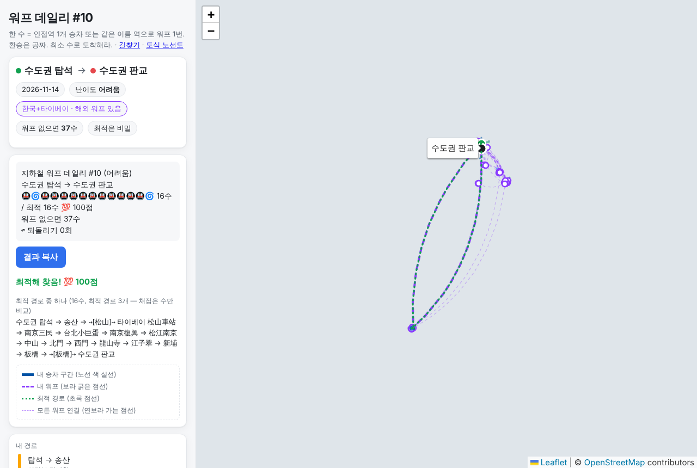
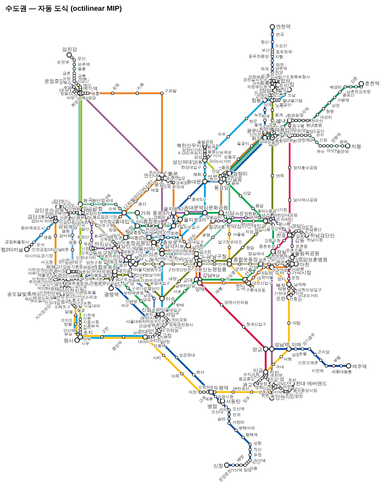
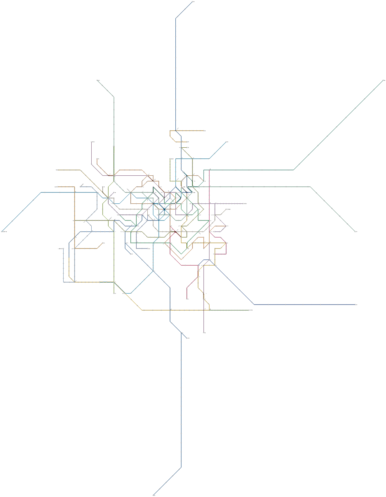
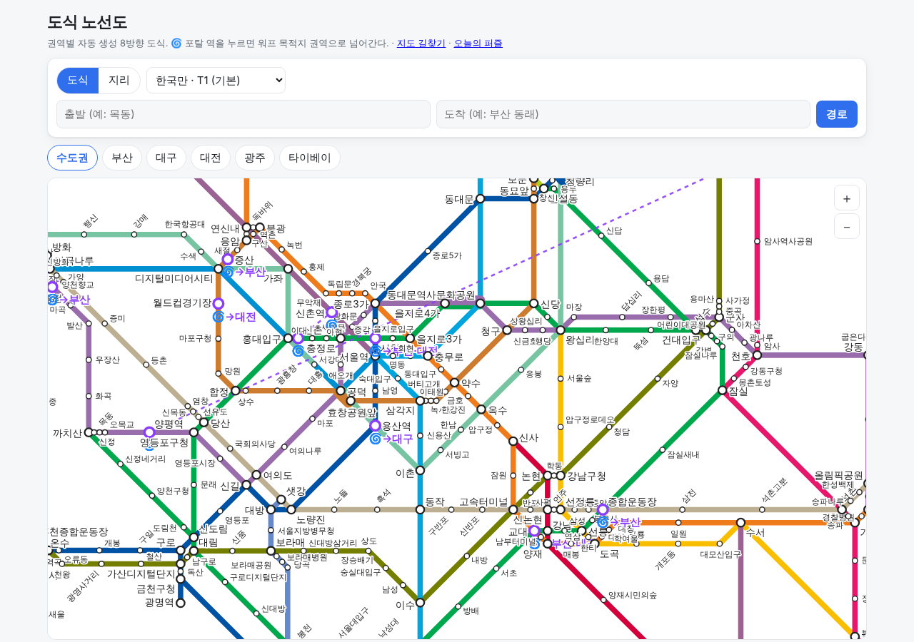

# 무인 작업 5차 R — 데일리 1년·'역' 표기·도식 결정성·수도권 도식 (run5-polish, PR #7)

- 시작: 2026-11-09T12:19:40Z (세션 시작 직후 `date -u`) · 명세: 사용자 /goal 메시지 R1~R4
- 시작 브랜치: PR #5·#6이 main에 머지돼 있어(2026-11-06) main에서 `run5-polish` 분기, draft PR #7 (베이스 main). T는 여기서 딴 `tokyo-phase1b`(PR #8)
- 커밋: `R3` 분리·지문 → `R4 (중간)` 웜스타트·중간 저장 → `R4` 라벨 → `R2` '역' 표기 → `R1` 1년 일정 → `R4` DOM 라벨 측정 → `R4` 수도권 장시간 풀이·LOOM 비교 (+ 이 보고서)
- 테스트: pytest **204 통과** (`evidence/pytest_run5_r.txt`), node **37 통과** (`evidence/node_test_run5_r.txt`), 브라우저 E2E 에러 0 (`evidence/run5_browser.txt`)
- 이번 세션에서 처리 순서 판단: R3(캐시 분리)을 먼저 해야 R4 장시간 풀이 결과를 캐시로 넣을 수 있어서 R3 → R4(백그라운드 2시간) → 그동안 R2·R1 → T.

## 요약

| 단계 | 상태 | 핵심 결과 |
| :- | :- | :- |
| R1 데일리 1년 | 완료 | **371일(53주) 일정, 하드 제약 위반 0** (상한 1/3·30일 4회 유지). 풀 확대 9안 비교: 4차 풀로 1년 위반 695, 할당 확대 15, 유일성 완화 12, **단축 하한 3→2 효과 없음**, **easy 시그니처 상한 2→6이 결정적(0)**, 주말 한국+타이베이 섞기 0(채택), 주말 타이베이만은 위반 남음. 풀 984, 서로 다른 시그니처 198, 주말 34일이 한국+타이베이. launch_date null |
| R2 '역' 표기 | 완료 | '역'을 떼면 도시·지역 이름(시·도·군)이 되거나 다른 역과 겹치는 클러스터 **50개**는 화면에 '역' 유지 (서울역·부산역·대전역·수원역·양평역 / 교대역(부산)·동래역(동해선)·신촌역·용산역 …). 매칭 정규화·포탈 키 그대로, 입력 '서울'·'서울역' 둘 다 |
| R3 도식 결정성 | 완료 | 풀이(20)와 웹 빌드(21) 분리. 캐시에 입력 지문·재현성 표시. 시간 제한 없이 끝난 5개 권역은 두 번 풀어도 좌표 동일, 21은 두 번 돌려도·커밋본과도 바이트 동일. 결정성 버그 2건 수정 |
| R4 수도권 도식 | 완료 | 지리 8방향 스냅 웜스타트 + 반복 간 웜스타트 + 백그라운드 2시간 풀이·중간 저장 → **교차 17 → 14, 굴곡 214 → 212, 평면성 반복 완료(새 교차·간격 위반 0)**. 웜스타트 없는 같은 예산 대조는 반복 3에서 2,700초 동안 해 없음(4차와 같은 막힘). LOOM(octi) 비교: 1분 안에 교차 7·지리 변위 0.113 (대신 역 사이 꺾임 114) |
| 라벨 배치 | 완료 | 노선 선분 클리핑 비용 + 8방위 후보. 실제 브라우저 글꼴 기준 수도권 선 위 라벨 **247 → 124**, 겹침 360 → 244 · 부산 23 → 4 · 대구 13 → 2 |

## 1. 단계별 완료 증거

### R1. 데일리 1년 일정 (4차 결정 반영)

비교: `python3 scripts/r1_compare.py` → `docs/reports/r1_daily_year.md`, `data/processed/daily_year_compare.json`. 일정: `python3 pipeline/10_build_game_data.py`.

- 일정 길이 **371일 = 53주**: 어느 365일 구간에서도 같은 퍼즐이 다시 나오지 않고, 길이가 7의 배수라 순환해도 요일별 난이도가 유지된다 (작성자 판단 — 364일이면 1년 안에 하루가 반복된다).
- 하드 제약은 4차 값 그대로: (i) 같은 시그니처 간격 ≥ 14일, (ii) 연속일 포탈 집합 자카드 ≤ 1/3, (iii) 30일 창 포탈당 ≤ 4회, (iv) 요일별 보정 난이도(월 easy → 토·일 hard) + 퍼즐 ruleset 요일.
- 변형은 누적 (앞 변형 + 한 가지):

| 변형 | 일정 | 풀 (easy/normal/hard) | 위반 (i/ii/iii/iv) | 서로 다른 시그니처 | 최다 포탈 (일정 비율) | 유일해 비율 | 주말 풀 일정 |
| :- | -: | :- | :- | -: | :- | -: | -: |
| V0 4차 설정 | 182 | 374 (31/187/156) | 0/0/0/0 | 102 | 시청 9.9% | 1.0 | - |
| V0y 4차 풀로 371일 | 371 | 374 (31/187/156) | 11/7/645/32 | 175 | 시청 21.8% | 1.0 | - |
| V1 할당 확대 200/150 | 371 | 652 (38/420/194) | 0/0/0/15 | 189 | 시청 10.5% | 1.0 | - |
| V2 + 유일성 완화 | 371 | 683 (41/438/204) | 0/0/0/12 | 201 | 시청 10.8% | 0.728 | - |
| V3 + 단축 하한 3 → 2 | 371 | 684 (41/439/204) | 0/0/0/12 | 201 | 시청 10.8% | 0.728 | - |
| V4 + easy 시그니처 상한 2 → 6 | 371 | 792 (90/451/251) | **0/0/0/0** | 179 | 시청 9.4% | 0.763 | - |
| **V5 + 주말 한국+타이베이 (섞어 편성) ← 채택** | 371 | 984 (102/582/300) | **0/0/0/0** | **198** | 시청 **8.9%** | 0.744 | 34 |
| V6 = V5, 주말은 한국+타이베이만 | 371 | 984 | 0/0/0/57 | 195 | 시청 9.7% | 0.765 | 60 |
| V8 = V6 + 주말 풀 확대 | 371 | 1,260 | 0/0/0/4 | 188 | **板橋 9.4%** | 0.725 | 102 |
| V7 = V5, 유일성 유지 (분리 실험) | 371 | 937 | 0/0/0/0 | 182 | 시청 8.9% | 1.0 | 25 |

- 해석:
  - **유일성 완화**: 위반을 15 → 12로 줄이고 시그니처를 189 → 201로 늘린다. 같은 V5 조건에서 유일성을 지키면(V7) 시그니처 182 — 완화 쪽이 다양하다. 채점은 최적 수만 비교하므로(명세) 완화를 채택했다. 웹은 최적해가 여럿이면 '최적 경로 중 하나 (최적 경로 n개 — 채점은 수만 비교)'로 보여 준다.
  - **단축 하한 3 → 2는 효과가 없다** (풀 +1). 선정이 단축 폭 큰 순이라 하한 근처 후보는 할당 안에 들지 못한다. 하한은 2로 두되 효과 없음을 기록.
  - **결정적인 건 easy 등급의 시그니처 상한**이었다. easy(워프 1회)는 시그니처가 포탈 하나라 '등급당 같은 시그니처 2개' 상한에 바로 걸려 월요일 53개를 못 채웠다(41개). 6으로 올리자 보정 easy 90개 → 위반 0.
  - **주말 한국+타이베이**: 섞어 편성(V5)하면 위반 0에 최다 포탈 비율이 9.4% → 8.9%로 내려가고 시그니처 179 → 198. 주말을 한국+타이베이로만 채우면(V6) hard 퍼즐이 모자라 위반 57, 주말 풀을 키워도(V8) 4가 남고 국가 간 포탈 6개 중 板橋로 쏠린다(9.4%).
- 채택안(V5) 최종 일정 (`data/processed/puzzles.json` stats): 풀 984 (기본 792 = easy 90 / normal 451 / hard 251, 주말 192 = easy 12 / normal 131 / hard 49), **일정 371일 위반 0**, 시그니처 최소 간격 14일, 연속일 자카드 최대 0.0, 30일 창 포탈 최다 4 (송정·시청·증산), 일정 전체 포탈 최다 시청 33/371 (8.9%).
  - 요일별 보정 등급: 월 easy 53 · 화~목 normal 53씩 · 금 normal 17 / hard 36 · 토·일 hard 53씩. 평균 난이도 지수 h: 월 0.0 → 화 0.304 → 수 0.454 → 목 0.543 → 금 0.618 → 토 0.70 → 일 0.81 (단조 증가).
  - 종류: crosscity 237, shortcut 134. ruleset: strict 337, tw_t12 34 (전부 토·일, 국가 간 워프 포함 — 테스트로 고정).
- 웹: 퍼즐마다 그 ruleset 번들을 읽는다 (`puzzle.js bundleFile`). 주말 한국+타이베이 퍼즐은 칩 '한국+타이베이 · 해외 워프 있음'.
- launch_date는 null 그대로 (append-only 고정은 출시 후에만 켜진다).
- 결정성: 국소탐색에 평가 횟수 상한(`repair_max_evals: 4000`, 시간이 아니라 횟수)을 넣었다 — 4차 풀로 371일(V0y)처럼 위반이 많이 남는 설정에서 국소탐색이 끝없이 돌던 것 방지.
- 브라우저 E2E (`scripts/e2e_run5.cjs`, `evidence/run5_browser.txt`):
  - 2026-11-14(토) #10 `수도권 탑석 → 수도권 판교` ruleset tw_t12: 최적 16수(松山 ⇢ 타이베이 → 板橋 ⇢ 판교), 최적 경로 3개, 100점
  - 2026-11-11(수) #7 `수도권 금정 → 대구 칠곡경대병원` strict: 24수, 100점

### R2. '역' 표기

- 규칙 (`config/display.yaml`, `metro_portal/names.display_names`): 표시 이름에서 '역'을 떼면 (a) **도시·지역 이름**(역 주소 앞 두 토큰의 시·도·군 이름, 주소 오기 2건 제외)과 같아지거나 (b) **같은 이름의 다른 물리적 역이 있고 이 클러스터의 원래 이름에 '역'이 있으면**, 그 클러스터와 소속 역 레코드는 화면에서 '역'을 유지한다. 한 물리적 역은 한 표기.
- 매칭 정규화는 그대로다 (포탈 키 `교대`·`양평`·`동래` 등 불변, 테스트로 고정). 길찾기 입력은 '서울'·'서울역' 둘 다 받는다.
- 결과: 한국 940 클러스터 중 50개.
  - (a) 지역 이름 33: 가평역 경산역 과천역 광명역 구리역 구미역 군포역 기장역 대전역 동두천역 부산역 부천역 서울역 성남역 수원역 아산역 안산역 안양역 양산역 양주역 양평역(5호선·경의중앙선 둘 다) 여주역 연천역 오산역 의왕역 의정부역 이천역 인천역 천안역 춘천역 파주역 평택역
  - (b) 겹침 17: 고촌역 교대역(부산) 금곡역 대곡역 동래역(동해선) 송정역 신천역 신촌역(경의선) 양정역 용문역 용산역 운천역 좌천역 죽전역 중동역 중앙역 화정역
- 적용: 웹 번들(클러스터·역 표시 이름 → 지도·데일리·도식 라벨), 도식 SVG 라벨. fun facts·보고서 텍스트는 정규화 이름 그대로.
- 테스트: pytest 5 (지역 이름·구 제외·겹침·부분 일치 금지·주소 토큰·실번들), node 기대값 갱신 + '서울'/'서울역' 입력 동일 결과.
- E2E: 길찾기 `서울 → 부산 동래` = `서울역 → 시청 ⇢ 부산 시청(연제) → … 교대역` (`evidence/r2_route_seoul.png`). 데일리 경로 표기 `안양역`, `용산역`, `죽전역`.

### R3. 도식 결정성 — 풀이 캐시와 웹 빌드 분리

- `pipeline/20_solve_schematic.py` (재계산, MIP) → `data/processed/schematic/<권역>.json` 캐시 (커밋). `pipeline/21_build_schematic_web.py`는 캐시만 읽어 `web/data/schematic.json`·SVG를 만든다. `build_all.sh`는 21만 돈다.
- 캐시마다 **입력 지문**(그래프 정점·좌표·엣지·노선 시퀀스·축약 결과·모델 파라미터 — 예산 키와 역 이름은 제외)과 **재현성 표시**(HiGHS 1.15.1, 스레드 1, 시드 7, 반복별 종료 상태, 시간 제한 도달 여부). 지문이 지금 그래프와 다르면 21이 멈추고 다시 풀 권역을 알려 준다. 작업량 기준 종료(`mip_max_nodes`) 옵션도 넣었다.
- 증거:
  - 부산·대구·대전·광주·타이베이를 두 번 풀어 좌표 완전 동일, 4차 결과와도 동일 (`reproducibility.deterministic = true`).
  - 21 단계를 두 번 돌린 번들 md5 동일, 커밋된 `web/data/schematic.json`과 바이트 동일 (pytest로 고정).
  - 수도권 4차 해는 `--adopt`로 정점·엣지·축약이 지금 그래프와 같은지 확인하고 지문만 찍었다 (재현 불가 표시) → R4 결과로 교체.
- 결정성 버그 2건 수정: (1) 데일리 통계의 포탈 동률 순서가 frozenset 순회(해시 시드)에 따라 바뀌던 것 → 이름순 동률 정렬, (2) fresh clone에서 `build_all.sh`가 Unihan을 받기 전에 18단계를 돌려 실패하던 순서.
- 테스트: `tests/test_schematic_cache.py` 5개 (지문: 그래프·모델 변화엔 바뀌고 예산·이름엔 안 바뀜 / 소형 문제 재현 / 낡은 캐시 감지 / 번들 바이트 동일 / 캐시 재현성 표시).

### R4. 수도권 도식 개선

- **방법** (`metro_portal/schematic.py solve_octilinear`, `pipeline/20_solve_schematic.py --long`, 설정 `config/schematic.yaml` 수도권 `long_run`):
  1. **지리 8방향 스냅 웜스타트** (첫 반복): 엣지 방향 = 지리 방향에 가장 가까운 8방향(허용 3방향 안) → 방향 고정 LP(직교 잔차·길이 부족에 벌점)를 8번 고쳐 풀어 맞는 방향을 찾고, 잔차가 남은 엣지 21개와 이웃을 뺀 256/350개 엣지의 방향을 HiGHS 부분해(`setSolution`)로 준다.
  2. **반복 간 웜스타트**: 평면성 반복(교차 제약 추가 → 재풀이)마다 앞 반복 해의 방향을 주되, 새 교차 제약이 붙은 엣지와 그 이웃만 비운다 (303~315/350개 고정). 4차에서 반복 3이 180초 안에 해를 못 찾던 지점이 여기였다.
  3. **장시간 풀이**: 반복당 900초, 갭 0.05, 최대 12반복, 전체 예산 7,200초. 백그라운드로 돌렸다 (웜스타트 有·無 두 실행을 같은 예산으로 병렬).
  4. **중간 저장**: 반복마다 `iter_<k>.json`(좌표·방향·교차 제약·지표), 반복 안에서는 HiGHS 개선해 콜백으로 60초마다 `incumbent.json` (`data/raw/schematic_runs/<권역>_<태그>/`, gitignore). `--resume`으로 마지막 반복의 방향·교차 제약에서 이어 푼다 (번호도 이어서). 시연: `evidence/r4_resume_demo.txt` (대구: 2반복 저장 → 이어 풀기 → 위반 0).
  5. **결과 선택·다듬기**: 체크포인트 반복 중 (교차, 남은 위반 쌍, 굴곡) 사전식 최소. 고른 반복의 엣지 방향과 교차 제약을 고정하고 좌표만 다시 풀어(1~2초) 정확한 8방향 좌표를 복원한다 — 체크포인트 좌표를 소수 4자리로 반올림해 저장하던 첫 구현에서 '8방향 아님 50'이 나와서 넣은 단계(이제 원래 정밀도로도 저장).
- **반복별 기록** (같은 예산, 지표는 전체 655역 기준, 교차에는 지리 좌표에도 있는 입체 교차 포함 — 지리 18):

| 반복 | 웜스타트 有: 교차 / 굴곡 / 목적값 / 남은 위반 | 웜스타트 無 (대조) |
| -: | :- | :- |
| 1 | 17 / 206 / 472.24 / 6 | 17 / 206 / 472.24 (같음) |
| 2 | 18 / 210 / 564.93 / 5 | 22 / 222 / 570.92 |
| 3 | 15 / 218 / 692.52 / 1 | **900초 안에 해 없음 → 멈춤** |
| 4 | 14 / 210 / 531.76 / 1 | - |
| 5 | 15 / 212 / 524.41 / 2 | - |
| 6 | **14 / 212 / 521.77 / 0 (평면성 반복 완료)** | - |

  모든 반복이 900초 시간 제한에 걸렸다(갭 0.05 미달). 웜스타트 有 실행은 5,535초, 無 실행은 2,703초에 끝났다.
- **고른 해**: 반복 4(교차 14·굴곡 210·위반 1)와 반복 6(교차 14·굴곡 212·위반 0)을 둘 다 다듬어 비교 → 교차가 같으면 위반이 없는 쪽(반복 6, 목적값도 527.84 → 518.77로 낮음)을 골랐다. 이 판단을 선택 규칙(교차 → 남은 위반 → 굴곡)으로 코드에 넣었다.

| | 엔진·상태 | 8방향 아님 | 교차 (지리 18) | 굴곡 45° (지리 343) | 변위 | 시간 | 재현 |
| :- | :- | -: | -: | -: | -: | -: | :- |
| 4차 캐시 (F안) | MIP, 반복 2 해 (반복 3 해 없음) | 0 | 17 | 214 | 0.31 | 240s | 불가 |
| 5차 대조 (웜스타트 無) | MIP, 반복 1 다듬기 | 0 | 17 | 206 | 0.281 | 2,703s | 불가 |
| **5차 채택 (웜스타트 有)** | **MIP, 반복 6 다듬기, 평면성 완료** | **0** | **14** | **212** | 0.328 | 5,536s | 불가 (캐시 사용) |
| LOOM octi (참고) | 휴리스틱, 1분 | 13 / 866 선분 (근사) | 7 | 326 + 엣지 안 114 (근사) | 0.113 | 52s | - |

- 캐시: `data/processed/schematic/seoul.json` (`status: 반복 6 방향 고정 다듬기`, 지문 e081d8a0d98b8f6c — 그래프·모델은 4차와 같고 예산만 바뀜), 웹 번들·SVG는 21 단계로 다시 만들었다. 브라우저 도식 E2E 19/19 (`evidence/run5_schematic_browser.txt` — 기존 4차 스크립트).

#### LOOM(octi) 비교

`python3 scripts/loom_compare.py` → `docs/reports/schematic/loom_compare.md`, `<권역>_loom.svg`. LOOM 커밋 `1e4757838104d1e4d22186c9b77d5fc4b98681a0` (SOURCES.md에 기록). 파이프 `loom | octi | transitmap`, octi 기본 설정(휴리스틱, 8방향 격자, 차수 2 축약, geo-pen 0).

| 권역 | LOOM 시간 | LOOM 교차 | LOOM 굴곡 (역 + 엣지 안) | LOOM 변위 | MIP 교차 | MIP 굴곡 | MIP 변위 |
| :- | -: | -: | :- | -: | -: | -: | -: |
| 수도권 | 51.7s | 7 | 326 + 114 | 0.113 | 14 | 212 | 0.328 |
| 부산 | 0.2s | 0 | 26 + 10 | 0.131 | 0 | 43 | 0.339 |
| 대구 | 0.3s | 0 | 14 + 8 | 0.267 | 0 | 20 | 0.404 |
| 대전 | 0.0s | 0 | 1 + 1 | 0.21 | 0 | 6 | 0.12 |
| 광주 | 0.0s | 0 | 1 + 1 | 0.245 | 0 | 3 | 0.196 |
| 타이베이 | 0.8s | 0 | 49 + 21 | 0.15 | 2 | 40 | 0.271 |

- 해석: LOOM은 훨씬 빠르고 지리 변위가 작다(형태를 덜 바꾼다). 교차도 적다. 대신 역 사이를 꺾인 선으로 그리고(엣지 안 꺾임), 수도권은 역 좌표 기준 굴곡이 많다(긴 교외선이 지리 방향을 따라가며 여러 번 꺾임). 자체 MIP는 역 사이 직선(엣지 안 꺾임 0)이라 웹 도식(직선 엣지 전제)에 그대로 쓴다.
- 측정 주의: octi 출력은 경위도라 웹 메르카토르로 투영하고, 꺾이는 곳의 둥근 모서리(짧은 선분 여러 개)를 더글러스–포이커 40m로 단순화한 뒤, 8방향은 각도 오차 2° 이내로 쟀다 — LOOM 쪽 8방향·굴곡 수치는 근사다. 굴곡의 '역' 항은 역 좌표를 직선으로 이었다고 보고 잰 값이라 LOOM의 실제 그림과 정확히 같지 않다.

| 자체 MIP (5차) | LOOM octi |
| :-: | :-: |
|  |  |

#### 라벨 배치 휴리스틱

- 비용 = 이미 놓은 라벨·역 원과 겹치는 넓이 + **노선 선분이 라벨 사각형 안을 지나는 길이 × 0.45·글자 높이** (회전 라벨은 라벨 좌표계로 돌려 Liang–Barsky 클리핑) + 후보 순번 × 0.01. 후보에 8방위(동·서·남·북·대각)를 더했다. 웹(`schematic_core.js placeLabels`)과 SVG(`schematic.py place_labels`) 같은 규칙.
- 같은 도식 좌표에서 4차 배치 vs 5차 배치:

| 측정 | 권역 | 선 위 라벨 4차 → 5차 | 겹침 쌍 4차 → 5차 |
| :- | :- | :- | :- |
| **실제 브라우저 글꼴 (DOM, 웹 기본 확대)** `scripts/e2e_labels_dom.cjs` | 수도권 (3배) | 247 → **124** | 360 → **244** |
| | 부산 | 23 → **4** | 19 → **10** |
| | 대구 | 13 → **2** | 28 → **18** |
| 추정 글꼴 (Python, `scripts/label_compare.py`, 5차 수도권 배치) | 수도권 3300px | 160 → 32 | 102 → 59 |
| | 수도권 1100px (보고서 SVG) | 323 → 224 | 908 → 742 |
| | 부산 · 대구 · 타이베이 | 12 → 0 · 12 → 1 · 27 → 4 | 9 → 0 · 6 → 1 · 11 → 2 |

  DOM 측정은 4차 수도권 배치에서 4차 웹(origin/main 워크트리)과 5차 웹을 같은 스크립트로 쟀다. R4 결과를 올린 뒤 5차 배치 + 5차 라벨은 선 위 131, 겹침 275 (`evidence/r4_labels_dom_v5final.png`). 지표 정의는 `docs/reports/r4_labels.md`. 수도권은 권역 전체가 커서 기본 확대(3배)에서도 도심 라벨 겹침이 남는다.

| 4차 (origin/main) | 5차 |
| :-: | :-: |
|  |  |

## 2. 미완 단계와 사유

- 명세 R1~R4 항목 중 빠진 것은 없다. 다만:
- **수도권 도식은 여전히 시간 제한 해다**: 반복당 900초·전체 2시간 예산 안에서 평면성 반복이 끝나지 않았다(마지막 반복에도 위반 쌍이 남음). 그래서 캐시에 `reproducibility.deterministic = false`로 표시했고, 웹 빌드는 캐시만 써서 결정적이다. 다른 기계에서 `20_solve_schematic.py --long`을 다시 돌리면 결과가 다를 수 있다.
- **LOOM**: 명세의 'octi 명령이 이미 설치돼 있으면'에 대해 — PATH에는 `octi`가 없었다(환경 설정 스크립트의 `make install` 미완). 설정 스크립트가 빌드해 둔 `/tmp/loom/build/octi`가 있어 그걸 그대로 썼다. 세션에서 받거나 빌드하지 않았다. LOOM 굴곡·8방향 수치는 둥근 모서리 단순화 때문에 근사다.
- **레일포털 원본 재수집 실패**: data.kric.go.kr에서 노선정보(28KB)만 받아졌고 역사정보 2개 파일은 6초 후 터널 종료(code 1006), 재시도에 프록시 502. 우회하지 않고 커밋된 `data/processed/kr`로 04단계부터 진행했다. 그래서 `scripts/q0_checklist.py`(원본 xlsx 필요)는 이번 세션에서 다시 못 돌렸고, `build_all.sh`를 fresh clone에서 처음부터 돌리면 01단계에서 멈춘다.
- 실기기 모바일은 이번에도 확인 못 했다 (Playwright 390×844 에뮬레이션만).
- 배포(Pages)는 main 머지 후에만 돈다 — 머지 금지라 미반영.

## 3. 가정·판단

- R1: 일정 길이 371일(53주), 주말 풀 ruleset은 tw_t12(T1+T2, 국가 간 포탈 6개가 다 있는 기본 ruleset), 주말 풀은 국가 간 워프를 쓰는 대표 경로만, 주말에는 한국 퍼즐과 섞어 편성. easy 시그니처 상한 6. 단축 하한은 효과가 없어도 명세대로 2로 낮췄다.
- R1: 유일해가 아닌 퍼즐의 '대표 최적 경로'는 역추적 첫 경로다(시그니처·포탈 겹침 계산에 쓴다). 다른 최적 경로가 다른 포탈을 쓸 수 있어 실제 포탈 반복은 조금 다를 수 있다.
- R2: '도시·지역 이름'은 시·도·군까지. 구(자치구) 이름은 넣지 않았다 — 넣으면 강남·구로·동래·해운대 등 수십 개가 더 '역'이 붙는다. 지역 이름 목록은 역 주소에서 뽑아 역이 있는 곳만 안다.
- R2: (b) 겹침 판정은 '원래 이름에 역이 있는 레코드가 하나라도 있으면' 클러스터 전체 유지 (부산 교대 = 1호선 '교대' + 동해선 '교대역' → '교대역').
- R3: 지문에서 예산 키(시간 제한·반복 수·갭·노드 제한·웜스타트)와 역 이름은 뺐다. 표시 이름(R2)을 바꿔도 도식을 다시 풀 필요가 없다.
- R4: 웜스타트는 권역 설정 `long_run`(수도권만)에서만 켠다. 작은 권역은 웜스타트가 일찍 해를 줘서 갭 조건으로 빨리 멈춰 오히려 굴곡이 늘었다(대구 20 → 24, 광주 3 → 5).
- R4: 체크포인트 반복 중 (교차, 굴곡) 사전식 최소를 고른다 (교차 우선). 고른 반복의 엣지 방향과 교차 제약을 고정해 좌표만 다시 푸는 다듬기로 정확한 8방향 좌표를 복원한다.
- R4 LOOM: octi 실행 파일은 환경 설정 스크립트가 빌드한 `/tmp/loom/build/octi`를 그대로 썼다 (`make install`이 안 끝나 PATH에 `octi`는 없었다). 내가 받거나 빌드하지 않았다.

## 4. 결정하거나 확인할 것

1. **R1 채택안(V5)**: 371일, 유일성 조건 없음, easy 시그니처 상한 6, 주말에 한국+타이베이 퍼즐 섞어 편성(34일). 주말을 한국+타이베이로만 채우길 원하면 주말 풀 hard 퍼즐이 더 필요하다(V8도 위반 4 + 板橋 쏠림).
2. **R1 일정 길이**: 371일(53주, 1년 안 반복 없음) vs 364일(52주). 지금은 371.
3. **R2 '도시·지역 이름' 범위**: 시·도·군만(지금). 구 이름(강남·구로·동래·해운대 …)까지 '역'을 붙일지.
4. **R4 수도권 결과 선택**: 체크포인트 반복 중 (교차, 굴곡) 사전식 최소(교차 우선)를 캐시에 올렸다. 굴곡을 더 중시하면 다른 반복을 `--polish seoul:warm:<반복>` + `--promote`로 바꿀 수 있다 (표 참고).
5. **LOOM 채택 여부**: LOOM(octi 휴리스틱)은 1분 안에 교차가 더 적고 지리에 더 가까운 배치를 낸다. 대신 역 사이를 꺾인 선으로 그리고(엣지 안 꺾임), 웹 도식(역 사이 직선 전제)에 넣으려면 폴리라인 지원이 필요하다. 웹 엔진을 LOOM으로 바꿀지, 자체 MIP를 유지할지.
6. **환경 설정 스크립트**: LOOM `make install`이 끝나지 않아 `octi`가 PATH에 없다. 설정 스크립트를 고칠지 (지금은 `/tmp/loom/build`를 직접 씀).
7. 출시일(launch_date)은 여전히 null — 정하면 append-only 고정이 켜진다.

## 5. 다음 할 일

- PR #7 리뷰·머지 → PR #8 머지 → Pages 배포본에서 실기기 확인.
- 수도권 도식: 남은 위반 쌍을 지역 분할(LNS)이나 더 긴 예산으로 풀거나, LOOM 결과를 웹 도식에 넣을 수 있게 폴리라인 지원.
- 레일포털 접근이 돌아오면 `scripts/q0_checklist.py` 재실행, 12월 개통 노선 활성화 검토.
- 데일리: 출시일 결정 후 append-only 고정 시험, 주말 3국 퍼즐(도쿄 포함, PR #8) 검토.
- 도식 페이지에 도쿄 패널 (1,300역 — 이번 R4 방식 그대로).
