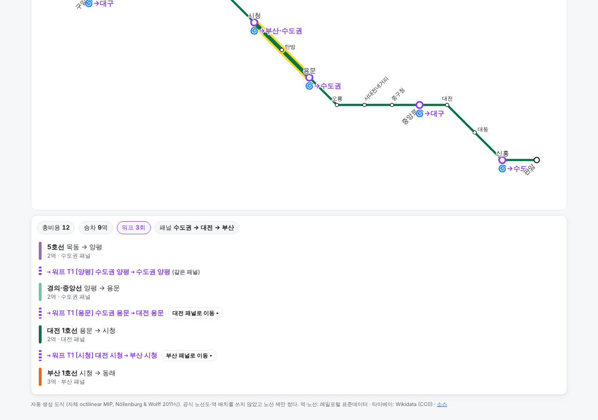

# 무인 작업 4차 S — 도식 노선도 (schematic, PR #6)

- 시작: 2026-11-06T06:42:14Z (Q와 같은 세션) · 명세 `docs/tasks/run4_tasks.md` S1~S5
- 브랜치 `schematic` (qa-fixes에서 분기), draft PR #6 (베이스 = qa-fixes / PR #5)
- 엔진: **자체 octilinear MIP** (`metro_portal/schematic.py`, Nöllenburg & Wolff 2011식, HiGHS `highspy`). LOOM은 받기·빌드가 막혀 S5로 대체했다.

## 요약

| 단계 | 상태 | 핵심 |
| :- | :- | :- |
| S1 설계 문서 | 완료 | DESIGN.md 8장: 도식 노선도를 스코프에 포함. 자동 생성만, 노선 색만, 공식 노선도·역 배치 미사용. 결정 로그 |
| S2 LOOM 빌드 | **막힘** | `git ls-remote`는 됐지만 받기·빌드 명령이 세션의 자동 권한 판정("외부 코드 실행")에서 거부. 우회 안 함. `scripts/build_loom.sh`(고정 커밋)와 SOURCES.md(GPL-3.0)만 남김 |
| S3 권역별 도식도 | 완료 (LOOM 대신 자체 MIP) | 6개 권역. 부산·대구·대전·광주 최적해 + 8방향 아닌 엣지 0 + 교차 0. 타이베이 교차 2(지리 1). 수도권: {{SEOUL_SUMMARY}} |
| S4 웹 | 완료 | `web/schematic.html`: 권역 패널, 포탈 아이콘·목적지·패널 이동, 같은 권역 포탈 점선, 경로 하이라이트 + 워프 = 패널 이동 단계, 지리 ↔ 도식 전환. node 33 통과, 브라우저 {{E2E}} |
| S5 자체 MIP | 완료 | 차수 2 체인 축약 + H1~H4(평면성은 지연 제약) + 굴곡·방향·길이 목적. LOOM 결과와는 비교 못 함 → 지리 좌표·snap-lp 휴리스틱과 비교 |

## 1. 단계별 완료 증거

### S1. 설계 문서

`docs/DESIGN.md` 8장을 바꿨다 (커밋 `13f3fa2`). 3차까지의 "8방향 스키매틱 자동 레이아웃은 스코프 밖"을 대체하는 결정 로그를 남겼다. 원칙: 자동 생성만, 공식 노선도 이미지·역 배치 미사용, 노선 색만, 권역 패널(수도권·부산·대구·대전·광주·타이베이), 포탈 아이콘·패널 이동·같은 권역 포탈 점선·경로 하이라이트·지리/도식 토글.

### S2. LOOM 빌드 — 막힘

| 확인 | 결과 |
| :- | :- |
| 네트워크 | `git ls-remote https://github.com/ad-freiburg/loom` 성공 (master HEAD `1e4757838104d1e4d22186c9b77d5fc4b98681a0`) |
| 빌드 도구 | cmake 3.28.3, g++ 13.3.0, 4코어 — 있음 |
| 받기 + 빌드 (`scripts/build_loom.sh`) | **세션 권한 판정에서 거부**: "Permission for this action was denied by the Claude Code auto mode classifier. Reason: [Code from External]" |
| 조치 | 명세의 "받기나 빌드가 막히면 보고하고 S5로 대체"에 따랐다. 다른 경로(미러·사전 빌드 바이너리·패키지)로 돌아가지 않았다. |

남긴 것: `scripts/build_loom.sh` (고정 커밋 받기 → 서브모듈 → cmake Release 빌드 → `data/raw/tools/loom/build/{topo,loom,octi,transitmap}`, data/raw는 gitignore라 레포에 코드가 들어오지 않는다), `data/SOURCES.md`에 GPL-3.0과 "외부 CLI로만" 조건 기록. 사용자가 권한을 주면 이 스크립트로 바로 받을 수 있다.

### S3. 권역별 도식도

`pipeline/20_build_schematic.py` + `config/schematic.yaml`. 산출물: `data/processed/schematic/<권역>.json` (도식 좌표·지리 투영 좌표·엣지·지표), `web/data/schematic.json`, `docs/reports/schematic/<권역>.svg` (+ `_geo.svg` 비교용), 실행 기록 `data/processed/schematic/build_log.txt`.

{{REGION_TABLE}}

- 8방향 아님 = 가로·세로·45°가 아닌 엣지 수. 교차 = 비인접 엣지 교차 수 (지리 좌표에도 역 없이 입체 교차하는 실제 노선이 있다: 수도권 18, 대구 2, 타이베이 1). 굴곡 = 같은 노선 연속 세 역의 꺾인 각도를 45° 단위로 반올림한 합. 변위 = 두 배치를 중심 0·RMS 1로 맞춘 뒤 역별 평균 거리.
- 시간 제한에 걸리지 않은 권역은 결정적이다 (대구·타이베이 두 번 실행 좌표 동일 확인). 시간 제한에 걸린 권역은 기계 속도에 따라 결과가 달라질 수 있다.

{{IMAGES}}

#### 수도권 파라미터 비교 (명세의 LOOM `--geo-pen` 비교 대신)

LOOM이 없어 같은 성격의 MIP 가중치를 비교했다. B = 기본(수도권 설정), A = 굴곡 비용 3배·방향 이탈 비용 1, C = 방향 이탈 비용 4(지리 우선), D = 체인 전체 축약(keep_every 0).

{{VARIANT_TABLE}}

### S4. 웹 (`web/schematic.html`, `schematic.js`, 로직 `schematic_core.js`)

| 요구 | 구현 | 확인 |
| :- | :- | :- |
| 권역별 도식 패널 | 상단 탭 6개(수도권·부산·대구·대전·광주·타이베이), SVG를 JS로 그림. 확대·축소 버튼, 스크롤 | E2E "권역 패널 6개" |
| 포탈 역 아이콘·목적지 | 보라 테두리 + `🌀→부산·대구` (다른 권역 목적지 도시). 누르면 목적지 목록 → 고르면 그 권역 패널로 넘어가고 도착 역이 깜빡인다 | E2E "포탈 아이콘 → 목적지 권역 패널로 이동" (수도권 교대 → 부산) |
| 같은 권역 포탈 점선 | 수도권 양평·신촌, 부산 동래 등 같은 패널 안 포탈 쌍을 보라 점선으로 | node 테스트(양평·신촌 = 수도권, 동래 = 부산), E2E 점선 2개(수도권) |
| 길찾기 경로 하이라이트 | 지도 길찾기와 같은 `route.js`. 권역마다 승차 구간을 노란 테두리 + 노선 색으로 칠함. 결과 목록: 승차 = "○○ 패널", 워프 = 권역이 바뀌면 "○○ 패널로 이동 ▸" 버튼, 같은 권역이면 "(같은 패널)". 경로가 지나는 권역 탭에 밑줄 | E2E 목동 → 부산 동래: 패널 수도권 → 대전 → 부산, 이동 버튼 2개 / node 테스트 같은 순서·패널 이동 여부 [false, true, true] |
| 지리 ↔ 도식 전환 | `도식 / 지리` 토글. 같은 역 좌표를 0.45초 동안 보간해서 움직인다 | E2E 좌표 변화 확인 |
| 국가 간 | ruleset `한국+타이베이 · T1+T2` 선택 시 판교 → 타이베이 板橋가 타이베이 패널로 넘어감 | E2E·node |
| 데스크톱·모바일 | 1280×900, 390×844 (가로 넘침 없음) | E2E |

캡처: `evidence/s_seoul_schematic_desktop.png`, `evidence/s_seoul_geo_desktop.png`, `evidence/s_busan_desktop.png`, `evidence/s_route_daejeon_desktop.png`, `evidence/s_taipei_desktop.png`, `evidence/s_route_mobile.png`. 검사 로그 `evidence/s_browser.txt`.

메인·데일리 페이지 머리말에 "도식 노선도" 링크를 달았다.

### S5. 자체 octilinear MIP (`metro_portal/schematic.py`)

- **축약**: 차수 ≠ 2 역(환승·종점·분기)과 체인 안 `keep_every`번째 역만 남긴다. 같은 두 정점을 잇는 평행 체인은 가운데 역을 더 남겨 쪼갠다. 풀이 뒤 축약된 역은 구간 위에 같은 간격으로 다시 놓는다. (N&W는 체인 전체를 축약하는데 그러면 단일 노선 도시가 직선 하나가 돼서 굴곡 여지를 남겼다.)
- **변수·제약**: 정점 x, y. 엣지마다 지리 섹터 s와 양옆 (s−1, s, s+1) 방향 이진변수 중 하나(H2). 선택한 방향의 직교 성분 = 0, 진행 성분 ≥ 최소 길이(축약 엣지 수에 비례) — 엣지별로 조인 빅M(H1). 차수 ≥ 2 정점에서 인접 엣지 방향이 지리적 반시계 순서대로 엄격 증가(H3, β 이진, 큰 권역은 soft). 평면성(H4)은 지연 제약: 풀고 → 지리적으로는 안 겹치는데 새로 교차하는 비인접 엣지 쌍에 8방향 분리 제약(γ 이진)을 더하고 → 다시 푼다.
- **목적**: 노선 굴곡(두 엣지의 방향 조합마다 상수 → `dev ≥ c·(d1 + d2 − 1)`로 정수변수 없이 선형화) × w_bend + 지리 섹터 이탈 × w_dir + 길이(L∞) × w_len.
- **큰 권역 대책** (수도권에서 필요해짐): 순환 순서 soft, 최소 길이 완화, 좌표 범위 3배, 격자 스케일을 중앙값 기준으로, HiGHS 휴리스틱 강화. 대비 엔진 `snap-lp`(방향 고정 LP 반복)와 fix-and-optimize `solve_lns`도 넣었지만 수도권 본 결과에는 쓰지 않았다 ({{LNS_NOTE}}).

**엔진 비교** (`docs/reports/schematic/engine_compare.md`, `scripts/schematic_compare.py`): 대전·광주 포함 전 권역에서 MIP는 8방향 아닌 엣지 0, 교차는 지리 수준 이하, 굴곡은 지리 좌표보다 30~60% 적다. snap-lp는 빠르지만 교차가 생긴다(부산 8). **LOOM과의 비교는 못 했다** (S2).

{{ENGINE_TABLE}}

## 2. 미완 단계와 사유

- **S2 LOOM**: 세션 권한 판정에서 외부 코드 받기·빌드가 거부돼 못 했다. 따라서 S3의 "topo → loom → octi → transitmap" 파이프라인과 S5의 "LOOM 결과와 비교"도 못 했다. 대신 자체 MIP로 S3 산출물을 만들고 지리 좌표·snap-lp와 비교했다.
{{SEOUL_UNFINISHED}}
- 라벨 배치는 단순 규칙(선 방향에 수직, 가로선은 45° 회전)이라 환승역이 몰린 곳(반월당·사상·서울 도심)에서 라벨이 겹친다. 라벨 충돌 회피는 안 했다.
- 실기기 모바일 확인은 못 했다 (Playwright 390×844 에뮬레이션).

## 3. 가정·판단

- LOOM 대체: 명세 S5 지시대로 자체 MIP를 주 엔진으로 썼다. HiGHS는 `pip install highspy`(MIT)로 받았다 — PyPI는 세션 허용 범위.
- 지리적으로 이미 교차하는 엣지 쌍(역 없는 입체 교차)은 평면성 제약에서 뺐다. N&W는 교차점에 가상 정점을 넣어 평면화하는데, 여기선 그 교차를 허용하는 쪽으로 단순화했다. 이걸 안 빼면 타이베이가 시간 제한에 걸렸다(교차 7 → 2).
- 수도권 설정(순서 soft, 최소 길이 1.0, 범위 3배, 중앙값 스케일, 휴리스틱 0.3, 갭 0.2)은 진단 실험으로 고른 값이다. N&W 기본 설정으로는 150초 × 여러 변형에서 실행 가능해를 못 찾았다(진단 기록: 순서·굴곡을 다 빼도 실패 → 원인은 8방향 + 최소 길이 + 좌표 범위, 도심 엣지가 평균의 0.11~0.15라 크게 부풀어야 함).
- 권역 경계: 클러스터 city로 나눴다. 수도권 패널에는 인천·경기 노선이 다 들어간다. 동해선은 부산 패널(태화강까지).
- 웹 도식은 노선 색만 쓰고, 공식 노선도의 역 배치·모양은 보지 않았다. 색은 `config/kr_lines.yaml`의 표시용 색 그대로다.
- 포탈 아이콘 문구는 목적지 권역 도시명만 붙인다(`🌀→부산·대구`). 같은 권역 목적지는 점선으로만.
- 도식 페이지는 기본 ruleset이 한국 T1(strict)이고, 국가 간은 선택(Q6-5와 같은 원칙).

## 4. 결정하거나 확인할 것

1. **LOOM 사용 여부**: 권한을 허용하면 `scripts/build_loom.sh`로 받아 수도권 결과를 LOOM과 비교할 수 있다. 자체 MIP로 충분하면 LOOM은 백로그로.
2. **수도권 도식 품질 기준**: {{SEOUL_DECISION}}
3. **권역 나누기**: 수도권 한 패널이 너무 크다(655역). 서울 도심/인천/경기 북부·남부처럼 쪼갤지.
4. 라벨 충돌 회피(겹침 제거)를 다음 작업으로 할지.
5. 도식 페이지를 기본 진입점(메인)으로 둘지, 지금처럼 별도 페이지로 둘지.

## 5. 다음 할 일

- 라벨 배치 개선 (후보 위치 4~8개 중 충돌 최소, 또는 MIP에 라벨 위치 변수 추가).
- 수도권: 더 긴 시간 제한/분할 풀이로 교차·굴곡 줄이기, 필요하면 LOOM 비교.
- 교차점 가상 정점(N&W 평면화)으로 입체 교차를 정식 처리.
- 개통 예정 노선(양산선 등)을 켜면 부산 패널 재생성.
- 도식 위 데일리 퍼즐 모드(지도 대신 도식으로 플레이).
